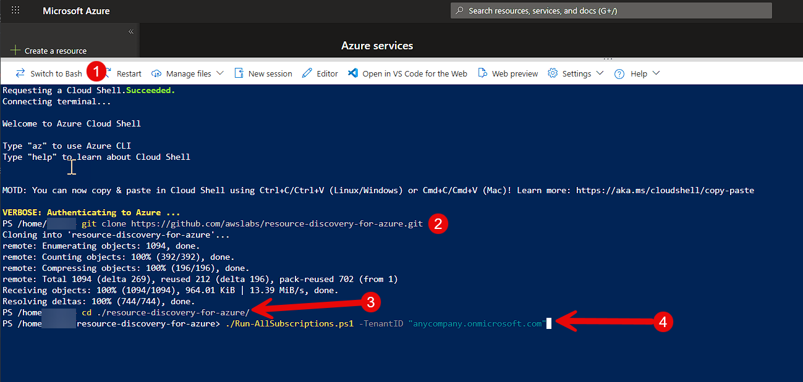
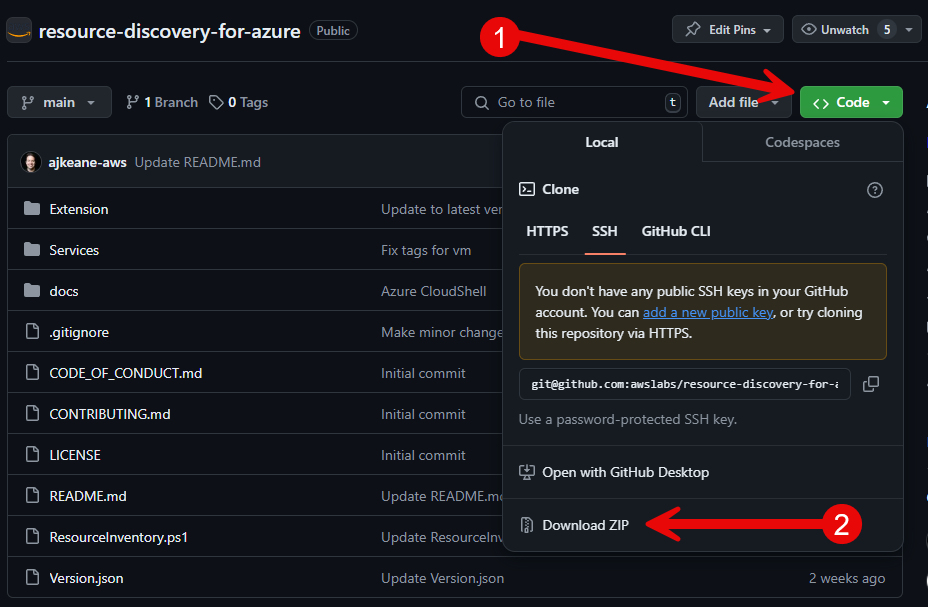

# Azure Resource Discovery Tool

## Overview

The Azure Resource Discovery Tool is a PowerShell script that generates comprehensive inventory reports of your Azure environment. This AWS-provided script creates detailed reports including resource metrics, usage statistics, and performance data from the previous 31 days.

This tool leverages read-only integrations with Azure APIs and Azure Monitor. Our goal is to deliver a reliable and efficient solution for Azure environment reporting, empowering you with comprehensive insights into your cloud resources and their utilization.

**Key Features:**
- Read-only Azure API integration
- Automated self-contained HTML and JSON report generation (no Excel/ImportExcel dependency)
- 31-day historical metrics collection
- Parallel processing for improved performance
- Support for [Azure Cloud Shell](https://shell.azure.com "Open Azure Cloud Shell") and local PowerShell environments

## Quick Start

For most users, this is everything you need.

**1. Open Azure Cloud Shell** at [shell.azure.com](https://shell.azure.com), or run a local PowerShell 7 prompt with the [prerequisites](#prerequisites) installed.

**2. Download the script:**

```powershell
git clone https://github.com/awslabs/resource-discovery-for-azure.git
cd resource-discovery-for-azure
```

**3. Run it:**

```powershell
./Run-AllSubscriptions.ps1 -TenantID "contoso.onmicrosoft.com"
```

This:
- Inventories every enabled subscription in the tenant.
- Produces a full-fidelity report with real resource names and IDs. If you need to share it externally (e.g. with the AWS team), add `-Obfuscate` to mask identifying details first — see [Obfuscation Mode](#obfuscation-mode).
- Automatically tunes how many subscriptions run in parallel to the machine's CPU and memory: small boxes (e.g. 2 vCPU) run one subscription at a time, larger boxes scale up. Add `-ParallelStreams <N>` (and/or `-ConcurrencyLimit <N>`) only if you want to override the auto-detected values.

The script tracks progress automatically as it goes. You don't need `-Resume` on the first run. Only if a run is interrupted (network drop, Cloud Shell session timeout, accidental Ctrl+C), re-run the same command with `-Resume` added — it skips the subscriptions that already finished and picks up the rest. See [Resuming an interrupted run](#resuming-an-interrupted-run) for details.

You'll find the consolidated report at `InventoryReports/AllSubscriptions_ResourcesReport_<timestamp>.zip`. This report contains real resource names and IDs. Before sharing it externally (e.g. with the AWS team), re-run with `-Obfuscate` to mask identifying details — see [Obfuscation Mode](#obfuscation-mode). You can also selectively un-mask an obfuscated report with `Reveal.ps1` if the recipient needs specific fields.

For larger tenants (100+ subscriptions), see [Choosing where to run](#choosing-where-to-run-for-large-tenants-cloud-shell-vs-local) for sizing guidance. For all available options, see the [Run-AllSubscriptions Wrapper Parameters](#run-allsubscriptions-wrapper-parameters).

## Table of Contents

- [Quick Start](#quick-start)
- [Prerequisites](#prerequisites)
- [Getting Started](#getting-started)
- [Usage](#usage)
- [Output Files](#output-files)
- [Parameters Reference](#parameters-reference)
- [Troubleshooting](#troubleshooting)

## Prerequisites

### Required Azure Roles

Before running the script, ensure your Azure user account has the following roles assigned:

- **✅ Reader Role** - Access to view Azure resources
- **✅ Billing Reader Role** - Access to billing data
- **✅ Monitoring Reader Role** - Access to Azure Monitor metrics

Reader (or any role that can read every resource type) is needed **on each subscription, or above it**. A custom role that leaves out reading some resource types (for example `*/read` with the not-action `Microsoft.Compute/*/read`) is not enough on its own and stops the run. Reader on only some resource groups stops a whole-subscription run; for one resource group, run `ResourceInventory.ps1` with `-SubscriptionID` and `-ResourceGroup` (see [Targeting a single subscription or resource group](#targeting-a-single-subscription-or-resource-group)).

Consumption (usage) data needs the permission `Microsoft.Commerce/UsageAggregates/read` on every subscription in the run, granted at the subscription or above (a role on a resource group does not return usage). The built-in **Reader** and **Billing Reader** roles include it. **Cost Management Reader does not**, so it is not enough for consumption data on its own.

Before any other work, the run checks the signed-in identity's roles on every subscription, then (when consumption is requested) that usage values come back, and stops with exit code 1 if either fails (see [Subscription access check](#subscription-access-check-up-front) and [Consumption data check](#consumption-data-check-up-front)).

### Environment Options

The script runs in either Azure Cloud Shell or a local PowerShell 7 install. Pick based on the size of the tenant you're inventorying:

| Tenant size | Use | Why |
|---|---|---|
| Up to ~30 subscriptions | **Cloud Shell** | Fastest to start. No setup, pre-authenticated, all dependencies included. |
| 30–100+ subscriptions | **Either**, with `-ParallelStreams 2 -Resume` on Cloud Shell | Cloud Shell still works, but session timeouts and the 3.5 GB RAM cap start to matter. `-Resume` lets a timed-out session pick up where it left off. |
| 100+ subscriptions, or metric-heavy tenants | **Local PowerShell 7** | Cloud Shell caps at `-ParallelStreams 2` (only 3.5 GB RAM / 2 vCPU). A local 16 GB / 8-core machine runs at `-ParallelStreams 6`, about 3× faster. Microsoft also warns that long-running parallel work in Cloud Shell can trigger anti-abuse blocking. See [Choosing where to run](#choosing-where-to-run-for-large-tenants-cloud-shell-vs-local) below for the full details. |

#### Option 1: Azure Cloud Shell

- Browser-based, no setup
- Pre-authenticated to your Azure tenant
- `Az` module pre-installed by Microsoft
- Access at [Azure Cloud Shell](https://shell.azure.com "Open Azure Cloud Shell")
- Sessions are ephemeral by default. Mount a storage account (Cloud Shell Settings > Reset User Settings > Mount storage account) if you need outputs to persist across sessions or want to use `-Resume` on a follow-up session.

#### Option 2: Local Environment
- **[Git](https://git-scm.com/downloads)** — required first. The recommended way to get the script is `git clone`, which also avoids Windows' Mark-of-the-Web / execution-policy friction. On a fresh Windows box without Git, install it before anything else (see [Step 2: Get the Script](#step-2-get-the-script) for the BITS-based silent install).
- [PowerShell 7 or later](https://learn.microsoft.com/en-us/powershell/scripting/install/installing-powershell)
- [Azure CLI](https://learn.microsoft.com/en-us/cli/azure/install-azure-cli)
- Azure CLI Resource-Graph Extension (auto-installed by script)
- **Az PowerShell module** — only four submodules are needed (install before running — see below)

> **On Windows with only Windows PowerShell 5.1?** The tool requires PowerShell 7. If you launch `Run-AllSubscriptions.ps1` from Windows PowerShell 5.1, it detects the old version and automatically re-launches itself under PowerShell 7, forwarding your arguments. If PowerShell 7 isn't installed, it offers to install it first (official Microsoft MSI) when run interactively. Nothing extra to do — just run the same command:
> ```powershell
> .\Run-AllSubscriptions.ps1 -TenantID "contoso.onmicrosoft.com" 
> ```

##### Installing the required PowerShell modules

> **Cloud Shell users:** `Az` is pre-installed by Microsoft. Skip this section entirely.

**You normally don't need to install anything by hand.** When you run `Run-AllSubscriptions.ps1`, its pre-flight bootstrap checks for the four Az submodules it needs (`Az.Accounts`, `Az.Compute`, `Az.Monitor`, `Az.Billing`) and, if any are missing, offers to install just those for you on interactive runs. It does this **before** any Az call — not mid-run — and then **verifies the module actually loads** (by importing `Az.Accounts`) before proceeding, so a broken/partial install is caught up front with a clear repair message instead of failing much later with confusing errors like "no consumption records". The tool needs only those four submodules, not the full ~80-submodule `Az` rollup (the full rollup works too — it loads only the four it needs). The report is a self-contained HTML file with no Excel/ImportExcel dependency, so there is nothing else to install.

**Optional — install by hand.** Do this only if you want to skip the prompt, are running **non-interactively** (the bootstrap won't prompt then, it fails loud with this same command), or are calling `ResourceInventory.ps1` **directly** — the inner script does *not* auto-install (by design, to avoid half-installed modules). From a **PowerShell 7** prompt (`pwsh`); `-Scope CurrentUser` needs no administrator elevation:

```powershell
Install-Module -Name Az.Accounts,Az.Compute,Az.Monitor,Az.Billing -Repository PSGallery -Force -AllowClobber -SkipPublisherCheck -Scope CurrentUser
```

If a previous run left a broken `Az` install behind, remove it and reinstall:

```powershell
Get-Module Az* -ListAvailable | Uninstall-Module -Force
Install-Module -Name Az.Accounts,Az.Compute,Az.Monitor,Az.Billing -Repository PSGallery -Force -AllowClobber -SkipPublisherCheck -Scope CurrentUser
```
  


## Getting Started

### Step 1: Access Your Environment

**For Azure Cloud Shell:**
1. Navigate to [Azure Cloud Shell](https://shell.azure.com "Open Azure Cloud Shell")
2. Ensure you're in PowerShell mode (not Bash)
3. You're automatically authenticated



**For Local Environment:**
1. Open PowerShell 7 as Administrator
2. Ensure Azure CLI is installed and configured

### Step 2: Get the Script

**Recommended — Git clone.** This is the smoothest path and sidesteps Windows' security friction entirely. Files created by `git clone` are written locally, so Windows does **not** tag them with the "Mark of the Web," and the scripts run under the default execution policy with **no unblocking and no execution-policy changes**.

```bash
git clone https://github.com/awslabs/resource-discovery-for-azure.git
```

> **Fresh Windows box without Git?** Install Git for Windows first, then clone. Downloading the installer with BITS is much faster than `Invoke-WebRequest`:
> ```powershell
> # Check https://github.com/git-for-windows/git/releases for the current version.
> Start-BitsTransfer -Source "https://github.com/git-for-windows/git/releases/download/v2.45.2.windows.1/Git-2.45.2-64-bit.exe" -Destination C:\git-setup.exe
> Start-Process C:\git-setup.exe -ArgumentList '/VERYSILENT /NORESTART' -Wait
> # Reopen PowerShell so Git is on PATH, then run the git clone above.
> ```

**Alternative — Download ZIP.** Works, but every file inside a GitHub ZIP is flagged by Windows as downloaded-from-the-internet (Mark of the Web), so PowerShell refuses to run the scripts until you unblock them or relax the execution policy — an extra step on each new machine.

1. Click the green **Code** button on this repository
2. Select **Download ZIP**
3. Extract to your desired directory
4. Unblock the files before running:
   ```powershell
   Get-ChildItem -Path . -Recurse | Unblock-File
   # or, session-only: Set-ExecutionPolicy -Scope Process -ExecutionPolicy Bypass
   ```



**Bottom line: prefer `git clone`** — it "just works" and avoids the execution-policy/unblock dance on every new desktop. See [Troubleshooting](#common-issues) if you must use the ZIP.

## Usage

### Authentication Notes

- **Azure Cloud Shell:** Authentication is automatic
- **Local PowerShell:** Run `az login` and `Connect-AzAccount` before executing the script. If you plan to scan all subscriptions in a tenant, use `Run-AllSubscriptions.ps1`, which prompts you to sign in once and then reuses the session for every subscription.

You might get more than one authentication request due to different collector processes running in parallel.

### Basic Execution

1. **Navigate to the script directory:**
   ```powershell
   cd resource-discovery-for-azure
   ```

2. **Run the script with your organization name:**
   ```powershell
   ./ResourceInventory.ps1 -ReportName "YourCompanyName" -ConcurrencyLimit 6
   ```

### Advanced Usage Examples

For most runs, use the `Run-AllSubscriptions.ps1` wrapper (recommended) — it inventories the whole tenant and forwards the common options (`-SkipConsumption`, `-SkipMetrics`, `-ConcurrencyLimit`, `-Obfuscate`, `-DeviceLogin`), so they behave exactly as they would on the inner script:

**Skip consumption (billing) data:**
```powershell
./Run-AllSubscriptions.ps1 -TenantID "contoso.onmicrosoft.com" -SkipConsumption
```

**Skip metrics:**
```powershell
./Run-AllSubscriptions.ps1 -TenantID "contoso.onmicrosoft.com" -SkipMetrics
```

**Tune the metrics throttle:**
```powershell
./Run-AllSubscriptions.ps1 -TenantID "contoso.onmicrosoft.com" -ConcurrencyLimit 8
```

To mask identifying details before sharing externally, add `-Obfuscate` — see [Obfuscation Mode](#obfuscation-mode).

#### Targeting a single subscription or resource group

The wrapper always covers the whole tenant. To scope a run to **one** subscription or a **single** resource group (producing one consolidated report), call `ResourceInventory.ps1` directly — the wrapper does not expose `-SubscriptionID` or `-ResourceGroup`. It accepts the same `-SkipConsumption`, `-SkipMetrics`, and `-Obfuscate` switches.

**Scan a specific subscription:**
```powershell
./ResourceInventory.ps1 -ReportName "CompanyName" -SubscriptionID "12345678-1234-1234-1234-123456789012"
```

**Scan a specific resource group** (`-ResourceGroup` needs `-SubscriptionID`):
```powershell
./ResourceInventory.ps1 -ReportName "CompanyName" -SubscriptionID "12345678-1234-1234-1234-123456789012" -ResourceGroup "MyResourceGroup"
```

Direct runs check Reader access up front too (see [Subscription access check](#subscription-access-check-up-front)). With `-ResourceGroup`, Reader on that one resource group is enough, and the [consumption data check](#consumption-data-check-up-front) looks for usage values of that resource group.

### Running Across All Subscriptions

Use `Run-AllSubscriptions.ps1` to generate a separate inventory report for each subscription in a tenant, instead of the default single consolidated report. The wrapper prompts you to sign in once, then invokes `ResourceInventory.ps1` for each subscription. By default subscriptions are processed sequentially (one at a time); use `-ParallelStreams` to process several concurrently.

```powershell
./Run-AllSubscriptions.ps1 -TenantID "12345678-1234-1234-1234-123456789012"
```

`-TenantID` accepts either a tenant GUID or a verified domain. When a domain is passed (for example `contoso.onmicrosoft.com`), the wrapper resolves it to the GUID via Microsoft's anonymous OIDC discovery endpoint before doing anything else, so this also works:

```powershell
./Run-AllSubscriptions.ps1 -TenantID "contoso.onmicrosoft.com"
```

Each subscription produces its own set of timestamped reports in `InventoryReports/`. After all subscriptions are processed, the wrapper bundles the per-subscription ZIPs into a single `AllSubscriptions_ResourcesReport_<timestamp>.zip` in the same folder for easy delivery.

#### Subscription state filter

By default, `Run-AllSubscriptions.ps1` only inventories subscriptions whose `State` is `Enabled`. Subscriptions in any other state (`Disabled`, `Warned`, `PastDue`, `Deleted`) are skipped because they return little or no data from Resource Graph and most ARM data-plane calls, so processing them produces near-empty reports while still costing wall-clock time.

To include every subscription regardless of state, pass `-IncludeDisabled`:

```powershell
./Run-AllSubscriptions.ps1 -TenantID "12345678-1234-1234-1234-123456789012" -IncludeDisabled
```

The wrapper prints the count of excluded subscriptions and a per-state breakdown so the filter is transparent.

#### Subscription access check (up-front)

Before doing any inventory work, `Run-AllSubscriptions.ps1` and a direct run of `ResourceInventory.ps1` check that the signed-in identity's roles let it read every in-scope subscription. This matters because Azure Resource Graph returns **zero rows rather than an authorization error** for a subscription the identity cannot read — so a missing Reader assignment is otherwise invisible until the finished report turns out to be silently missing subscriptions.

For each subscription the check uses two answers: the identity's own role assignments (including roles given through groups) with their role definitions, and Azure's report of the identity's effective permissions there. A subscription passes when both show read access, or when the identity cannot see its role assignments (it has no `Microsoft.Authorization` read) and Azure reports read access. With any other result the subscription is not readable, including when the two answers disagree: role changes can take a few minutes to reach every Azure service, so after changing roles wait about 5 minutes before re-running. A direct run with `-SubscriptionID` and `-ResourceGroup` checks that resource group instead, so Reader on that resource group is enough. The check runs with or without `-SkipConsumption`; when consumption is requested it also prints whether the roles include the usage permission, which the [consumption data check](#consumption-data-check-up-front) uses for subscriptions that return no usage values.

A subscription that is not readable is **skipped**: right after the check the run lists each one (name, id, the roles it found, and the reason) with the fix, and collects the other subscriptions. The skipped subscriptions are listed again at the end of the run, because the report does not contain them. Skipping does not change the exit code. This applies to `Run-AllSubscriptions.ps1` and to a direct run of `ResourceInventory.ps1` over every visible subscription. When **no** checked subscription is readable, for example the one a direct run names with `-SubscriptionID`, the run lists them with the fix and **stops before doing any work** with exit code 1 (for `-Resume`, see below).

`-AllowPartialAccess` is still accepted, so existing command lines keep working, but skipping is now the default and the switch changes nothing.

On `-Resume`, only the subscriptions that still need processing are checked. When none of them is readable but the resume state records other subscriptions in the run as completed, `-Resume` does not stop: it skips and lists the unreadable ones as above and finishes the run with nothing left to collect. That run uses one stream whatever `-ParallelStreams` is, so the completed subscriptions are skipped, not collected again; its `Parallelism:` line says so. When it clears the resume state it also deletes the per-stream state files an interrupted parallel run left, so the next `-Resume` starts fresh. When no subscription in the run is recorded as completed, `-Resume` stops like any other run, and the fix ends in running `-Resume` again: a run without `-Resume` checks the same subscriptions, and when the identity has no read role on them it stops the same way. A run without `-Resume` stops whenever none of the subscriptions it checks is readable. A subscription skipped because its check could not finish, or because the two answers disagree (usually right after a role change), stays on the retry list (`FailedAttempts`) as a failed run, also when the run stops: the resume state is kept, `-Resume` and `-ResumeFailedOnly` check it again, and the retry limit ends its retries if it keeps failing. One skipped because the identity has no read role is not put on the retry list. If a skipped subscription is on the retry list, the end-of-run `Pending Retries` lines name it with its reason and the fix to apply before `-ResumeFailedOnly` can retry it. The check runs once, before subscriptions are split across parallel streams, so it applies to both sequential and parallel runs. Role assignments at a management group or the tenant root count.

Read access means one role that can read **every** resource type. Azure Resource Graph leaves out, without an error, the resources of any type the identity cannot read, so a role whose not-actions remove reads of some resource types (a not-action that, with `*` standing for any characters, can match an action ending in `/read`, such as `*/read`, `Microsoft.Compute/*`, `Microsoft.Comp*`, `Microsoft.Compute/*/r*` or `Microsoft.Compute/virtualMachines/read`, but not `Microsoft.Compute/*/delete` or `*/write`) does not count, and the subscription is not readable, with a reason such as `role 'Custom reader' at subscription excludes 'Microsoft.Compute/*/read'; the inventory would miss those resources`. Not-actions confined to `Microsoft.Authorization`, `Microsoft.Commerce`, `Microsoft.Consumption` or `Microsoft.Billing` are allowed, because the inventory reads no resources of those namespaces; the text before the first `*` must name the namespace and a `/`, so `Microsoft.Authorization/*` is allowed but `Microsoft.Auth*`, which can also match other namespaces, is not. Each role is judged on its own, as Azure does, so Reader next to such a custom role passes. Two narrower roles that only together cover every resource type do not count either; add Reader instead. Such a subscription is skipped like any other that is not readable.

The list says what to do for each cause: grant Reader (no read access, or a resource group that is not found), re-run (the check could not finish, for example persistent throttling or a role assignment list longer than 1000 pages), or wait 5 minutes and re-run (the two answers disagree, usually right after a role change).

#### Consumption data check (up-front)

Consumption (usage) data is what prices the business case: it shows whether a machine ran 4 hours or 400. Azure's usage API returns **no error and zero rows** to an identity that lacks `Microsoft.Commerce/UsageAggregates/read`, so without a check a missing permission only shows up as an empty consumption sheet in the finished report.

Whenever consumption is requested (`-SkipConsumption` not passed), `Run-AllSubscriptions.ps1` and a direct run of `ResourceInventory.ps1` both check every subscription the run will process (the readable ones; skipped subscriptions are not checked), before any inventory or metrics work. A subscription passes when the same query the consumption phase runs (daily usage for the last 31 days, ending at the start of yesterday in UTC) returns at least one usage row with a quantity above zero. The window is worked out once per run and the consumption phase collects that same window, even for a subscription collected after midnight. A direct run with `-ResourceGroup` checks that resource group: only usage rows whose resource is in it count (the rows its consumption sheet keeps), and the resource group is not checked when Resource Graph shows no resources in it. Throttling, timeouts and server errors are retried with a short backoff; a permission error or a rejected request is not retried.

A subscription that holds resources but returns no usage above zero (no rows, or only zero quantities) **passes with a yellow warning** (outcome `NoUsage`) when the role check confirmed `Microsoft.Commerce/UsageAggregates/read` for it at the subscription or above by both of its answers: the identity's role assignments and Azure's effective permissions. The warning names the role and scope, the window, the typical causes (a new subscription, only free resources such as virtual networks or network security groups, or paused resources), and that the subscription's consumption sheet will be empty. These subscriptions are listed again at the end of the run. The exit code is not changed.

The run lists every failing subscription (name, id, outcome and the window queried) with the fix, and **stops with exit code 1**, when any subscription:

- returns no usage above zero and the usage permission was not confirmed by both answers (for example role assignments not visible to the identity, the two answers disagreeing, or the permission granted only on a resource group);
- returns a permission error (`Denied`), or an error that persists after the retries (`Error`).

To inventory without consumption data, re-run with `-SkipConsumption`. The check reads at most 50 pages of usage per subscription; if none of them has a quantity above zero it is treated as only zero quantities, and the output says only the first 50 pages were read. When that subscription passes as `NoUsage`, the warning says only that the first 50 pages held no usage above zero, not that its consumption sheet will be empty: the consumption phase reads every page.

A subscription with no resources at all in Resource Graph is not checked, because there is nothing to price, and the output says so.

On `-Resume` and `-ResumeFailedOnly`, only the subscriptions the run will process are checked. When `Run-AllSubscriptions.ps1` runs `ResourceInventory.ps1` for each subscription, the check is not repeated.

Both up-front checks run up to 8 subscriptions at a time and print one line per subscription, in subscription order. Every Azure call names its subscription, so the checks never switch the Azure context. Per subscription, the role check makes 2 Azure calls (the role assignment list and Azure's effective permissions; a `-ResourceGroup` run with consumption also asks for the subscription's permissions), and each role definition is read once per run. The consumption data check calls the usage API that the consumption phase's `Get-UsageAggregates` wraps, with the same window and options, once per page until a usage value above zero comes back (usually one call), plus one Resource Graph query per 1,000 subscriptions for the resource counts.

#### Resuming an interrupted run

For tenants with many subscriptions, the run can be cut short by environment-level limits — for example, an Azure Cloud Shell session that ends when a Conditional Access policy enforces a maximum session lifetime. The wrapper supports resuming:

```powershell
./Run-AllSubscriptions.ps1 -TenantID "12345678-1234-1234-1234-123456789012" -Resume
```

After each subscription is fully processed (its per-subscription ZIP has been written), the wrapper records the subscription ID in a state file at `InventoryReports/.resume-state-<TenantID>.json`. Re-running with `-Resume` reads that file and skips subscriptions that are already complete; the partially processed subscription (the one that was running when the session ended) is re-run from the start. The state file is cleared automatically after a clean run with no failures.

`-Resume` is opt-in. Without it, the wrapper processes every subscription returned by `Get-AzSubscription`, and existing state is left untouched.

#### Parallel subscription processing

For large tenants, the slowest part of the run is collecting metrics. Each call to Azure Monitor takes 200–500 ms over the network, and a typical subscription with VMs, SQL DBs, and storage accounts produces thousands of these calls. Done one subscription at a time, that adds up to many hours.

Pass `-ParallelStreams N` to process N subscriptions concurrently in separate `pwsh` background processes:

```powershell
./Run-AllSubscriptions.ps1 -TenantID "12345678-1234-1234-1234-123456789012" -ParallelStreams 6
```

Each stream is a separate background process. They don't share state with each other. Each has its own Azure session, its own progress tracking file, and its own output folder. The wrapper splits your subscription list across the streams in round-robin order so the workload stays balanced even when subscriptions vary in size.

The default is `-ParallelStreams 1` (existing sequential behavior, fully preserved). Pick a higher value based on the environment you're running in. See the table in [Choosing where to run for large tenants](#choosing-where-to-run-for-large-tenants-cloud-shell-vs-local) below.

`-ParallelStreams` and `-ConcurrencyLimit` compose. `-ConcurrencyLimit` throttles the metrics-collection runspace pool *within* one subscription; `-ParallelStreams` is the count of subscriptions running concurrently. Useful combinations:

| ParallelStreams | ConcurrencyLimit | Concurrent ARM calls (in flight at once) | Verdict |
|---|---|---|---|
| 1 | 6 | 6 | Existing default. |
| 6 | 6 | 36 | Recommended for metric-heavy estates on a 16 GB / 8-core local machine. |
| 8 | 6 | 48 | Watch for HTTP 429s in per-stream logs. |
| 6 | 12 | 72 | Aggressive. Expect retry-backoff to eat the gain. |

When you run with `-ParallelStreams`, several things change in the output:

- The wrapper's own narration (which subscription a stream is starting, which one it finished) is prefixed with `[stream-N]`. The inner script's `Write-Host` and `Write-Log` output is **not** prefixed and will interleave across streams in the transcript. Use the per-stream summary at the end of the run, or the per-stream failures log, to disambiguate.
- Each stream writes its own failure log to `InventoryReports/RunAllSubscriptions_failures_<timestamp>_stream-<N>.log`. At the end of the run, the wrapper merges those into a single combined failure log so you only have one file to read.
- Each stream tracks its own progress in a separate resume-state file. When the run finishes, those are merged into the main resume-state file. This means `-Resume` works the same way regardless of whether the previous run was sequential or parallel — but only if the previous run reached the post-aggregation step. If you Ctrl+C a parallel run mid-stream, the per-stream resume files are still on disk; running `-Resume` on the next attempt will read them and skip the subs each stream had already completed. A per-stream file that cannot be read (for example one cut short when the session ended) is not used: the run prints a warning naming it, renames it in place to `<name>.unreadable-<UTC time>`, with `-2`, `-3` and so on added when that name is taken (kept for inspection; no later run reads it, and neither the wrapper's zips nor a zip step that takes `*.json` files picks it up), collects the subscriptions it listed again (under `-ResumeFailedOnly`, which retries only the retry list, a later `-Resume` collects them), and, when the run reaches its end, says whether the resume state was cleared or kept instead of `Resume state cleared (clean run).` The end-of-run merge of a parallel run does the same with a per-stream file it cannot read (a later `-Resume` collects its subscriptions). A file that cannot be moved aside is left alone and named with the command that removes it: at the start the run stops there with exit 1, before it collects anything; found by the end-of-run merge, the run ends with exit 1 in place of 0 and 3-5 (exit 2 keeps its code). If a resume state file cannot be removed at the end of a run that clears the state, the run names it in a warning and does not print `Resume state cleared (clean run).`; when a per-stream state file is left, the main resume state file is kept as well, so the next `-Resume` reads the same state again.

Authentication only happens once. The wrapper saves the parent process's Az PowerShell context to a file and each stream loads it, so you don't get prompted to sign in again for each parallel worker. The wrapper deletes that snapshot file when the run ends, including if you cancel with Ctrl+C or a stream crashes during startup.

#### Choosing where to run for large tenants: Cloud Shell vs local

Three things constrain how many parallel streams you can usefully run:

- **Azure Resource Manager (ARM) request quota.** ARM is Azure's control-plane API that the script calls to read resource details and metrics. Each subscription is rate-limited to roughly 12,000 read requests per hour. The script's `-ConcurrencyLimit` and `-ParallelStreams` together control how many ARM requests are in flight at once. Stay under about 50 concurrent requests per tenant, or you'll start seeing HTTP 429 ("Too Many Requests") in the per-stream logs and the script will spend more time backing off than working.
- **CPU cores.** The script is mostly waiting on network responses, not crunching numbers, so it doesn't need many cores. Roughly one core per stream is plenty. Running more streams than cores doesn't make the script faster, the CPU just spends time switching between tasks.
- **RAM.** Each stream loads the Azure PowerShell modules and holds resource and metric data in memory before writing the output files. Plan for around 500-700 MB peak per stream. Running more streams than your RAM can hold makes the OS swap to disk and slows everything down.

For small to medium tenants (up to a few dozen subscriptions), Cloud Shell is the easiest place to run. For large tenants the resource ceilings on Cloud Shell start to matter.

Verified Cloud Shell limits (measured 2026-05; Microsoft can change these silently):

| Resource | Cloud Shell | Notes |
|---|---|---|
| RAM | ~3.5 GB total, ~2.7 GB usable at idle | Each `pwsh` worker peaks at ~500–700 MB during the metrics phase |
| CPU | 2 vCPUs (Intel Xeon Platinum @ 2.8 GHz) | Shared, so effective throughput is lower under load |
| Storage | ~50 GB overlay filesystem | Ephemeral by default. See below. |
| Idle timeout | 20 minutes | Sessions are terminated without warning when this elapses |
| Concurrent sessions per tenant | 20 | Tenant-wide cap |
| Sudo / elevation | Not available | Module installs must use `-Scope CurrentUser` |

References: [Cloud Shell features](https://learn.microsoft.com/en-us/azure/cloud-shell/features), [Cloud Shell FAQ](https://learn.microsoft.com/en-us/azure/cloud-shell/faq-troubleshooting).

Recommended `-ParallelStreams` per environment:

| Environment | Recommended | Why |
|---|---|---|
| Cloud Shell (ephemeral or with mounted storage) | **2** | Saturates both vCPUs without OOM-killing workers on the 3.5 GB RAM cap |
| Local PowerShell 7, 8 GB RAM | **2** | RAM is the bottleneck |
| Local PowerShell 7, 16 GB RAM, 8+ cores | **6** | Recommended for metric-heavy estates |
| Local PowerShell 7, 32 GB RAM, 12+ cores | **8** | Watch HTTP 429s in per-stream logs. |

**Persistence in Cloud Shell:** Cloud Shell sessions are ephemeral by default. When your session ends, anything in your home directory is deleted, including the script's output and the resume-state file. The wrapper detects this at startup and warns you. To keep outputs across sessions (and to make `-Resume` work after a session times out), attach a storage account: in Cloud Shell, click Settings (the gear icon) > Reset User Settings > Mount storage account.

**Cloud Shell anti-abuse limits:** Microsoft warns that Cloud Shell is "not a general purpose computing platform" and that excessive usage can result in your tenant being blocked from Cloud Shell ([source](https://learn.microsoft.com/en-us/azure/cloud-shell/faq-troubleshooting#terminal-output---sorry-your-cloud-shell-failed-to-provision-codetenantdisabled-)). Long parallel runs against large tenants can trigger this. If you're running RDA across many subscriptions for a few hours at a time, use a local PowerShell 7 install instead. It avoids the risk and is usually faster anyway.

#### Run transcript and failure diagnostics

Every time you run `Run-AllSubscriptions.ps1`, it writes a transcript of the whole run to `InventoryReports/RunAllSubscriptions_transcript_<timestamp>.txt`. This is different from the per-subscription transcripts that the inner script `ResourceInventory.ps1` writes inside each subscription folder. The wrapper transcript covers the run end-to-end: which tenant was resolved, how authentication was handled, any resume-state messages, which subscription is being processed at each step, the final consolidation, and the run summary. You get this file every run, whether you process one subscription or many.

If a subscription fails, the wrapper also writes a structured failure log to `InventoryReports/RunAllSubscriptions_failures_<timestamp>.log`. This file captures the full exception type, the error message, up to five levels of inner exceptions, the script line number, the stack trace, and a snapshot of how much memory and free disk space the machine had when the failure happened. The final summary points at both files when failures occur.

Inside each subscription's report folder, the inner script also writes a consolidated **local debug log**, `DebugLog_<ReportName>_<timestamp>.log` — the per-collector heartbeat (each collector's start/finish/failure) plus the metrics-phase diagnostics that used to scroll past on the terminal. It stays **local** and is never added to the shared ZIP: it can contain real service/resource names and raw exception text, so keep it for your own troubleshooting.

Obfuscated runs (`-Obfuscate`) additionally produce a **shareable diagnostics log**, `Diagnostics_<ReportName>_<timestamp>.log`, which **is** included in the report ZIP. It is human-readable and scrubbed — subscriptions appear as their obfuscated tokens and other identifiers are masked — and it summarises phase timings plus one-line health entries for any collector failures, metrics auth-skips, and consumption failures (including exactly where a consumption pull stopped, so a truncated billing sheet is obvious rather than something you have to infer). Because it is safe to share, it can go to the AWS team alongside the report to explain any gaps without exposing real names. It is a plain `.log` on purpose so the ingestion pipeline treats it as an attachment, not as report data.

When reporting an issue, attach the wrapper transcript and the failure log (and, for obfuscated runs, the in-ZIP diagnostics log). The local `DebugLog_*.log` carries the most detail — share it too if you've confirmed it doesn't expose sensitive names. Together they contain enough context to diagnose most failures without a follow-up round trip.

## Output Files

Upon completion, the script generates reports in the `InventoryReports` folder:

### Generated Files

| File | Description |
|------|-------------|
| `Consumption_ResourcesReport_(date).csv` | Cost and billing data |
| `Inventory_ResourcesReport_(date).json` | Complete resource inventory |
| `Metrics_ResourcesReport_(date).json` | Performance metrics data |
| `ResourcesReport_(date).html` | Self-contained HTML report (open in any browser; no Excel required) |
| `Transcript_Log_<ReportName>_(date).txt` | Plaintext transcript of script activity (excluded from the zip when `-Obfuscate` is used) |
| `DebugLog_<ReportName>_(date).log` | Consolidated **local** debug log — per-collector heartbeat + metrics diagnostics. Never added to the zip (may contain real names/exception text) |
| `Diagnostics_<ReportName>_(date).log` | Shareable, scrubbed diagnostics summary (phase timings + collector/metrics/consumption health). **Included in the zip on `-Obfuscate` runs only** |
| `ResourcesReport_(date).zip` | All files compressed |

### File Delivery

1. **Locate the output:** Check the `InventoryReports` folder
2. **Rename the ZIP file:** Include your company name (e.g., `CompanyName_ResourcesReport_2024-01-15.zip`)
3. **Deliver to AWS team:** Send the renamed ZIP file for analysis

### Obfuscation Mode

Obfuscation is **opt-in** (off by default). Add `-Obfuscate` to mask identifying details so the report can be shared externally — it works on both entry points:

```powershell
# Whole tenant (per-subscription reports):
./Run-AllSubscriptions.ps1 -TenantID "contoso.onmicrosoft.com" -Obfuscate

# Single consolidated report:
./ResourceInventory.ps1 -ReportName "CompanyName" -Obfuscate
```

When using `-Obfuscate`, the following data is masked in all output files:

| Category | What is masked | Masked Format |
|----------|---------------|---------------|
| Resource ID | All resource IDs across inventory, metrics, and consumption | `prod_<guid>` or `nonprod_<guid>` |
| Resource Name | All resource names | `prod_<guid>` or `nonprod_<guid>` |
| Subscription | Subscription names (deterministic — same real sub always maps to the same value) | `prod_<guid>` or `nonprod_<guid>` |
| Resource Group | Resource group names (deterministic — same real RG always maps to the same value) | `prod_<guid>` or `nonprod_<guid>` |
| Tags | Tag **keys** kept verbatim; tag **values** tokenized deterministically (same value maps to the same token) | `prod_<guid>` or `nonprod_<guid>` |
| Cross-references | Fields that reference other resources by name or ID (e.g. DatabaseServer, ManagedInstance, HostId, StorageAccount, KeyVault, WAF policy) | Dictionary lookup or `obfuscated` |
| Consumption IDs | ReservationId and ReservationOrderId in billing data | `obfuscated` |
| Free-text / identity | Free-form fields that can carry PII (Description, FriendlyName, CreatedBy, RoleName, container image/name, IoT host/endpoint, automation account/runbook names) — tokenized deterministically, not dropped | `prod_<guid>` or `nonprod_<guid>` |

Resources with names matching dev/test/qa patterns (including short prefixes like `d-`, `t-`, `s-`) get a `nonprod_` prefix; all others get `prod_`. This preserves environment classification without exposing real names.

**Deterministic mapping:** The same real subscription or resource group always maps to the same obfuscated value within a run. This means pivot tables, grouping, and cross-referencing all work correctly in the obfuscated output.

**Reverse-lookup dictionary:** A local `ObfuscationDictionary_*.json` file maps every obfuscated value back to the real value. This file stays with the customer and is never included in the ZIP. Use `Reveal.ps1` locally to produce a NEW ingestible ZIP (same structure as `-Obfuscate`) with only the dimensions you choose un-masked — `-Fields ResourceGroup,Subscription,Tag,ResourceName,ResourceId,FreeText` for a selective reveal, or `-All` for a full un-obfuscate. See [docs/obfuscation-and-unmask.md](docs/obfuscation-and-unmask.md) for details.

**What is preserved:** Location, SKU, VM size, OS type, disk type, metrics values, consumption quantities, and all technical configuration data needed for analysis.

**What is excluded from the ZIP:**
- Transcript log (contains raw console output with emails, subscription IDs, file paths)
- Obfuscation dictionary (contains the real-to-obfuscated mapping)

### Manual Compression (If Needed)

If automatic compression fails:
```powershell
cd InventoryReports
Compress-Archive -Path ./* -DestinationPath "CompanyName_ResourcesReport_$(Get-Date -Format 'yyyy-MM-dd').zip"
```
## Parameters Reference

### Core Parameters

| Parameter | Type | Description | Example |
|-----------|------|-------------|----------|
| `ReportName` | String | **Required.** Company/customer name for file naming | `-ReportName "AcmeCorp"` |
| `TenantID` | String | Target specific Azure tenant | `-TenantID "12345678-1234-1234-1234-123456789012"` |
| `SubscriptionID` | String | Scan single subscription only | `-SubscriptionID "12345678-1234-1234-1234-123456789012"` |
| `ResourceGroup` | String | Scan specific resource group only | `-ResourceGroup "Production-RG"` |
| `OutputDirectory` | String | Full path to write reports to. Defaults to `~/InventoryReports` (or `C:\InventoryReports` on Windows). Must be the full path. | `-OutputDirectory "/data/rda-out"` |

### Performance Parameters

| Parameter | Type | Description | Default | Example |
|-----------|------|-------------|---------|----------|
| `ConcurrencyLimit` | Integer | Parallel execution limit | 6 | `-ConcurrencyLimit 8` |
| `SkipConsumption` | Switch | Skip cost/billing data collection and the up-front [consumption data check](#consumption-data-check-up-front) | False | `-SkipConsumption` |
| `SkipMetrics` | Switch | Skip Azure Monitor metrics collection | False | `-SkipMetrics` |
| `MetricsLookbackDays` | Integer | Days of metric history to collect for the trend metrics. Lower values reduce run time and memory use. | 31 | `-MetricsLookbackDays 14` |

### Metrics Lookback Window

`MetricsLookbackDays` shortens the history window for the **trend / utilization**
metrics only. Lowering it (e.g. 31 → 14 or 7) reduces both run time and memory
use, which helps on large estates that time out or hit out-of-memory errors
during the metrics phase. It does **not** change which resources are found, and
it does **not** affect cost/consumption data (that phase uses its own fixed
window).

The tradeoff is right-sizing accuracy: a shorter window samples fewer
peaks/cycles, so utilization-based sizing is based on a smaller sample. For
migration assessments prefer **14 over 7** so at least one full weekly cycle is
captured.

**Group A — bound to the lookback window. These DO shrink when you go 31 → 7/14:**

| Metric | Resource | Granularity |
|--------|----------|-------------|
| Percentage CPU | VMs, VMSS | 15-min (VM) / 1-hr (VMSS) |
| Available Memory Bytes | VMs, VMSS | 15-min / 1-hr |
| cpu_percent, memory_percent | SQL, MariaDB, MySQL(+Flexible), PostgreSQL(+Flexible) | 30-min / 1-hr |
| cpu_used, dtu_used | SQL DB | 30-min |
| physical_data_read_percent, log_write_percent | SQL DB | 1-hr |
| FunctionExecutionCount/Units | Functions | daily |

Capacity and point-in-time metrics (storage used, limits, CosmosDB throughput,
ACR storage, serverless SQL `app_cpu_billed`) use a fixed 1-day window and are
**not** affected by this setting.

### Privacy & Obfuscation Parameters

| Parameter | Type | Description | Example |
|-----------|------|-------------|----------|
| `Obfuscate` | Switch | Replace resource IDs, names, subscriptions, resource groups, and tags with masked values. A reverse-lookup dictionary is saved locally. Reports can be safely shared externally without exposing sensitive Azure environment details. | `-Obfuscate` |

### Authentication Parameters

| Parameter | Type | Description | Example |
|-----------|------|-------------|----------|
| `Appid` | String | Service Principal application ID | `-Appid "app-id-here"` |
| `Secret` | String | Service Principal client secret | `-Secret "secret-here"` |
| `DeviceLogin` | Switch | Use device code authentication | `-DeviceLogin` |

### Debugging Parameters

| Parameter | Type | Description | Example |
|-----------|------|-------------|----------|
| `Debug` | Switch | Enable debug mode output | `-Debug` |

### Run-AllSubscriptions Wrapper Parameters

These are the parameters specific to `Run-AllSubscriptions.ps1`. The wrapper forwards `-DeviceLogin`, 
`-Obfuscate`, `-SkipMetrics`, `-SkipConsumption`, and `-ConcurrencyLimit` to the inner `ResourceInventory.ps1`, so they behave the same in both contexts.

| Parameter | Type | Description | Default | Example |
|-----------|------|-------------|---------|---------|
| `TenantID` | String | **Required.** Azure tenant GUID or verified domain. The wrapper resolves a domain to its GUID via OIDC discovery before authenticating. | — | `-TenantID "contoso.onmicrosoft.com"` |
| `Resume` | Switch | Skip subscriptions already completed in a prior run. Reads from `InventoryReports/.resume-state-<TenantID>.json`. State is cleared automatically after a clean run. | False | `-Resume` |
| `ResumeFailedOnly` | Switch | Retry **only** the subscriptions that failed in a prior run, skipping both already-completed and never-attempted ones. Use this after a run finishes with a handful of failures (e.g. transient throttling) to re-run just those instead of walking the whole tenant again. `-Resume` continues an interrupted run (failed **and** not-yet-attempted subs); `-ResumeFailedOnly` targets failures only. | False | `-ResumeFailedOnly` |
| `IncludeDisabled` | Switch | Include subscriptions whose state is not `Enabled` (e.g. `Disabled`, `Warned`, `PastDue`). By default these are skipped because they return little or no data. | False | `-IncludeDisabled` |
| `AllowPartialAccess` | Switch | Accepted so existing command lines keep working; it changes nothing. Skipping unreadable subscriptions (listed at the start and the end of the run) and collecting the rest is now the default (see [Subscription access check](#subscription-access-check-up-front)). | False | `-AllowPartialAccess` |
| `ParallelStreams` | Integer | Number of subscriptions to process concurrently. `1` (default) is the existing sequential behavior. See [Parallel subscription processing](#parallel-subscription-processing) for sizing guidance. | 1 | `-ParallelStreams 6` |
| `ConcurrencyLimit` | Integer | Forwarded to the inner script's metrics-collection throttle. Controls how many `Get-AzMetric` calls run in parallel within one subscription. | 6 | `-ConcurrencyLimit 12` |
| `Obfuscate` | Switch | Forwarded. Replace resource IDs, names, subscriptions, resource groups, and tags with masked values. | False | `-Obfuscate` |
| `SkipMetrics` | Switch | Forwarded. Skip Azure Monitor metrics collection. | False | `-SkipMetrics` |
| `SkipConsumption` | Switch | Forwarded. Skip cost/billing data collection and the up-front [consumption data check](#consumption-data-check-up-front). | False | `-SkipConsumption` |
| `DeviceLogin` | Switch | Forwarded. Use device-code authentication (browser flow with a code). | False | `-DeviceLogin` |

## Troubleshooting

### Common Issues

**Downloaded ZIP File:**
- If you download the ZIP file, Windows may mark the files as blocked for security reasons which is a known issue from GitHub
- Run the following PowerShell command to unblock all files in Resource Discovery in Azure folder  
   `Get-ChildItem -Path . -Recurse | Unblock-File`
- After unblocking, you can execute the script from the folder

**Authentication Errors:**
- Ensure you have the required Azure roles assigned
- For local environments, run `az login` before executing the script
- Multiple authentication prompts may appear due to parallel processing
- "Get-AzSubscription returned no subscriptions" — usually a Conditional Access / MFA gate. Re-run with `-DeviceLogin` to use the browser-based device-code flow.
- Tenant-domain-style `-TenantID` (e.g. `contoso.onmicrosoft.com`) is resolved via Microsoft's public OIDC discovery endpoint, no sign-in needed. Pass the tenant GUID directly if discovery fails.

**Subscription returned 0 resources:**
- Both scripts stop up front when the identity's roles do not let it read a subscription (see [Subscription access check](#subscription-access-check-up-front)), so a subscription that passed that check and returned 0 resources is genuinely empty; the wrapper labels it that way at the end of the run.
- Failed subs are listed at the end of the wrapper transcript and in `InventoryReports/RunAllSubscriptions_failures_<timestamp>.log`.

**"subscription(s) are NOT readable by the signed-in identity" (those subscriptions are skipped; the run stops only when none is readable):**
- `no role grants read access (roles visible: ...)`: none of the listed roles can read resources at the subscription (for example Reader on one resource group only, or Billing Reader only). Grant Reader at the subscription, or for one resource group run `ResourceInventory.ps1 -SubscriptionID ... -ResourceGroup ...`.
- `no read access (role assignments not visible to this identity)`: the identity cannot see its role assignments and Azure reports no read access. Grant Reader at the subscription.
- `role assignments show ..., but Azure reports ...`: the two answers disagree, usually right after a role change. Wait about 5 minutes and re-run.
- `role check inconclusive after retries`: throttling or a network error persisted, or the identity's role assignment list was longer than 1000 pages; re-run.
- `role '...' at ... excludes '...'; the inventory would miss those resources`: the role reads resources except some resource types, which Resource Graph would leave out without an error. Grant Reader at the subscription (Reader beside the custom role is enough).

**Run stops immediately with "Consumption data was requested (no -SkipConsumption), but ... returned no usage values":**
- Whenever consumption is requested, `Run-AllSubscriptions.ps1` and a direct run of `ResourceInventory.ps1` check that every subscription in the run returns usage values before doing any other work (see [Consumption data check](#consumption-data-check-up-front)). If one does not, the run lists each failing subscription and **stops with exit code 1** rather than producing a report without consumption data.
- Each failing subscription shows one of these outcomes: `NoRows` (the query succeeded but returned no usage rows; for a `-ResourceGroup` run, none for that resource group), `NoPositiveQuantity` (rows came back, none with a quantity above zero, or none in the first 50 pages), `Denied` (the query was refused for lack of permission), or `Error` (any other failure that persisted after retries).
- `NoRows` and `NoPositiveQuantity` stop the run only when the role check did not confirm the usage permission by both of its answers. A subscription whose roles and Azure's effective permissions both include it passes with a yellow `NoUsage` warning instead (see [Consumption data check](#consumption-data-check-up-front)): typically a new subscription, one with only free resources, or one whose resources are paused. Its consumption sheet is empty.
- Fix: give the signed-in identity `Microsoft.Commerce/UsageAggregates/read` on each listed subscription, at the subscription or above. The built-in **Reader** and **Billing Reader** roles include it; **Cost Management Reader does not**. Under "Usage permission found by the role check" the run says per subscription whether its roles include it.
- If the identity already has it, the subscription may be partner-managed (CSP) without cost visibility for this identity, or on an offer the legacy usage API (`Get-UsageAggregates`) does not serve.
- Or re-run with `-SkipConsumption` to inventory without consumption data.

**Consumption sheet empty across many subs:**
- Usually a broken `Az` PowerShell module install (manifest present, bundled MSAL/Azure.Core assemblies missing or version-mismatched).
- The wrapper surfaces this loudly at end-of-run if the consumption-record count is 0 or many subs failed in the consumption phase.
- Reinstall: `Get-Module Az* -ListAvailable | Uninstall-Module -Force; Install-Module -Name Az.Accounts,Az.Compute,Az.Monitor,Az.Billing -Repository PSGallery -Force -AllowClobber -SkipPublisherCheck -Scope CurrentUser`

**Cloud Shell session ended mid-run:**
- Cloud Shell terminates inactive sessions after 20 minutes; long parallel runs can hit the same wall.
- If you mounted storage (Settings > Mount storage account), the resume-state file persists. Re-launch a Cloud Shell and run with `-Resume` to skip already-completed subs.
- Without mounted storage, all output is lost on session end. Move to a local PowerShell 7 install for runs that may exceed the timeout.

**Performance Issues:**
- Reduce `ConcurrencyLimit` if experiencing timeouts
- Use `SkipConsumption` to speed up execution. This is not recommended, as it greatly reduces the usefulness of the report.
- Consider targeting specific subscriptions or resource groups
- For tenants with many subscriptions, use `-ParallelStreams` (see the Cloud Shell sizing table above).

**VM `OSName` shows the image name (or is based on OS type):**
- `OSName`/`OSVersion` come from the in-guest VM agent, exposed by Azure via `properties.extended.instanceView`. Azure frequently returns these as null — always for stopped/deallocated VMs, and often even for running VMs with a healthy agent (a documented Azure platform limitation, [azure-cli#9284](https://github.com/Azure/azure-cli/issues/9284) / [azure-powershell#9470](https://github.com/Azure/azure-powershell/issues/9470)). A live per-VM instance-view call returns the same nulls, so it is not a reliable source.
- To keep the column meaningful, when the agent value is absent the report falls back to the VM's source image identity (image offer + SKU, e.g. `WindowsServer 2025-datacenter-azure-edition`), and finally to the OS type (`Windows`/`Linux`). Both of these are always populated by Resource Graph and require no extra calls.
- `OSVersion` still comes straight from the agent and may be blank when the agent does not report it; the image build is available separately in the `ImageVersion` column.

**HTML Report:**
- The report is a single self-contained `.html` file — open it in any browser. No Excel or ImportExcel module is required.
- It works the same in Azure Cloud Shell and locally; nothing extra to install.
- For a PDF, open the report and use your browser's Print > Save as PDF (the report has a print-friendly layout that expands every section).

**Missing resource types in the report ("Collector Failures"):**
- If a specific resource type (e.g. AKS, VMSS) is unexpectedly absent from a subscription's report even though that resource type exists in Azure, check the run's console output for a `Collector FAILED:` line and the end-of-run "Collector Failures" summary.
- This means the corresponding `Services/*/*.ps1` collector threw for that subscription — the resource type is **missing because the collector errored**, not because there are genuinely none of that type. The rest of the inventory still completes and the report is still produced.
- Re-run to retry. If the same collector keeps failing, investigate the error message shown (it is not swallowed).
- If 5 or more collectors fail back-to-back for the same subscription, the run stops early for that subscription — this pattern almost always means something systemic broke mid-run (auth dropped, network lost, a broken `Az` module), not a bug in one specific collector.

### Exit Codes (Run-AllSubscriptions.ps1)

The wrapper script sets a process exit code so automation/CI can detect problems without parsing console output:

| Code | Meaning |
|---|---|
| `0` | Clean run — no failures of any kind. |
| `1` | Hard failure during pre-flight, authentication, or setup (the run did not meaningfully start), or, found at the end of a run, a per-stream resume state file that cannot be read or moved aside (below). This includes the consumption data check stopping the run because a subscription returned no usage values (see [Consumption data check](#consumption-data-check-up-front)), and a per-stream resume state file that cannot be read and cannot be moved aside: at the start of `-Resume` or `-ResumeFailedOnly` the run stops before it collects anything, and found by the end-of-run merge the run ends with exit 1 in place of 0 and 3-5. |
| `2` | Per-subscription output verification gap (a subscription reported success but its output zip is missing). |
| `3` | Completed, but a requested data phase (Metrics and/or Consumption) was skipped for one or more subscriptions due to an authentication problem — see the "FAILED (auth)" banner. |
| `4` | Completed, but one or more `Services/*/*.ps1` collectors failed for one or more subscriptions — see the "FAILED (collectors)" banner and "Collector Failures" summary. Affected resource types are missing (not empty) from those subscriptions' reports. |
| `5` | Both `3` and `4` occurred in the same run. |

Codes `3`–`5` still mean the report was produced — they flag that it is **incomplete** in a specific, diagnosable way, rather than silently looking like a clean/empty result.

A direct run of `ResourceInventory.ps1` also ends with exit code `1` when the consumption data check stops it.

### Important Notes

- The script does not upgrade existing PowerShell modules
- Resource-Graph extension installs automatically if missing
- All operations are read-only and safe to execute
- Historical data covers the previous 31 days

